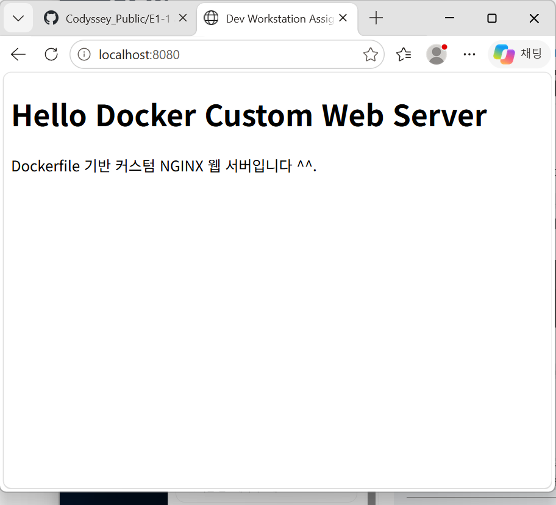
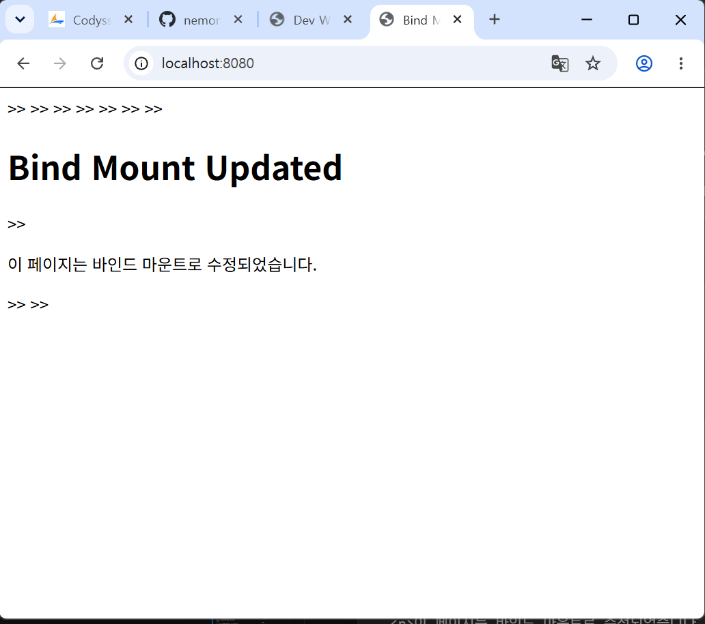

# Codyssey_Public
Github와 Codyssey를 연동하기 위해 만들어진 Repository입니다.

# 개발 워크스테이션 구축 과제
## 1. 프로젝트 개요

이 저장소는 개발 워크스테이션 구축 과제 제출용 저장소입니다.

본 과제의 목표는 터미널 기본 조작, 파일 권한 이해, Docker 설치 및 운영, dockerfile 기반 커스텀 웹 서버 제작, 포트 매핑, 바인드 마운트, Docker 볼륨 영속성, Git/GitHub 연동 과정을 직접 수행하고 그 결과를 문서화하는 것입니다.

최종적으로 이 README만 읽어도 전체 수행 과정과 검증 결과를 확인할 수 있도록 작성했습니다.
---

## 2. 실행 환경

| 항목 | 내용 |
|---|---|
| OS |  Ubunto 22.04 LTS(WSL2), Windows WSL  |
| Shell | bash,  PowerShell |
| Terminal | Windows Terminal, VSCode Terminal |
| Docker | 아래 명령 결과 참고 |
| Git | 아래 명령 결과 참고 |

### 실행 환경 확인 로그

```bash
$ uname -a
[Linux GNIA-C201-H04 6.18.54.1-microsoft-standard-WSL2 #1 SMP PREEMPT_DYNAMIC Tue Oct  6 19:13:07 UTC 2026 x86_64 GNU/Linux]

$ echo $SHELL
[/bin/bash]

$ docker --version
[Docker version 29.9.2, build a82e528]

$ git --version
[git version 2.53.0]
```

---

## 3. 수행 항목 체크리스트

- [x] GitHub Repository 생성
- [x] README.md 기술 문서 작성
- [x] 터미널 기본 조작 수행
- [x] 현재 위치 확인
- [x] 목록 확인, 숨김 파일 포함 확인
- [x] 디렉토리 이동
- [x] 파일/디렉토리 생성
- [x] 파일 복사
- [x] 파일 이동/이름 변경
- [x] 파일 삭제
- [x] 파일 내용 확인
- [x] 빈 파일 생성
- [x] 파일 권한 변경 실습
- [x] 디렉토리 권한 변경 실습
- [x] Docker 설치 및 버전 확인
- [x] Docker 데몬 동작 확인
- [x] Docker 이미지 다운로드 및 목록 확인
- [x] Docker 컨테이너 실행/중지/삭제
- [x] Docker 로그 확인
- [x] Docker 리소스 상태 확인
- [x] hello-world 컨테이너 실행
- [x] ubuntu 컨테이너 실행 및 내부 명령 수행
- [x] Dockerfile 직접 작성
- [x] 커스텀 이미지 빌드
- [x] 웹 서버 컨테이너 실행
- [x] 포트 매핑 접속 검증
- [x] 바인드 마운트 반영 검증
- [x] Docker 볼륨 영속성 검증
- [x] Git 사용자 정보 및 기본 브랜치 설정
- [x] GitHub 원격 저장소 연동
- [x] VSCode GitHub 연동 증거 첨부
- [x] 트러블슈팅 2건 이상 기록
- [x] 민감정보 마스킹 확인

---

## 4. 프로젝트 폴더 구조

```bash
$ sudo apt update
  sudo install tree
  tree
[tree 명령이 없다면 ls -R 출력 붙여넣기]
```

예상 구조:

```text
.
├── README.md
├── Dockerfile
├── site
│   └── index.html
├── evidence
│   ├── screenshots
│   └── logs
└── notes
```

---

## 5. 터미널 기본 조작 로그

### 5-1. 현재 위치 확인

```bash
$ pwd
[실제 출력 붙여넣기]
```

### 5-2. 목록 확인

```bash
$ ls
[실제 출력 붙여넣기]

$ ls -la
[실제 출력 붙여넣기]
```

### 5-3. 디렉토리 이동

```bash
$ cd site
$ pwd
[실제 출력 붙여넣기]

$ cd ..
$ pwd
[실제 출력 붙여넣기]
```

### 5-4. 디렉토리 및 파일 생성

```bash
$ mkdir terminal-practice
$ touch terminal-practice/empty.txt
$ ls -la terminal-practice
[실제 출력 붙여넣기]
```

### 5-5. 파일 내용 작성 및 확인

```bash
$ echo "hello terminal" > terminal-practice/hello.txt
$ cat terminal-practice/hello.txt
hello terminal
```

### 5-6. 파일 복사

```bash
$ cp terminal-practice/hello.txt terminal-practice/hello-copy.txt
$ ls -la terminal-practice
[실제 출력 붙여넣기]
```

### 5-7. 파일 이동 및 이름 변경

```bash
$ mv terminal-practice/hello-copy.txt terminal-practice/renamed.txt
$ ls -la terminal-practice
[실제 출력 붙여넣기]
```

### 5-8. 파일 삭제

```bash
$ rm terminal-practice/renamed.txt
$ ls -la terminal-practice
[실제 출력 붙여넣기]
```

---

## 6. 절대 경로와 상대 경로 정리

### 절대 경로

절대 경로는 루트 디렉토리부터 시작하는 전체 경로입니다.

예시:

```text
/home/user/dev-workstation-assignment/site/index.html
```

현재 위치와 관계없이 항상 같은 위치를 가리킵니다.

### 상대 경로

상대 경로는 현재 작업 중인 디렉토리를 기준으로 표현하는 경로입니다.

예시:

```text
./site/index.html
../README.md
```

현재 위치가 바뀌면 같은 상대 경로라도 다른 파일을 가리킬 수 있습니다.

---

## 7. 파일 및 디렉토리 권한 실습

### 7-1. 실습 파일 생성

```bash
$ mkdir -p permission-practice
$ echo "permission test" > permission-practice/file.txt
$ ls -l permission-practice/file.txt
[실제 출력 붙여넣기]
```

### 7-2. 파일 권한 변경 전/후 비교

```bash
$ chmod 644 permission-practice/file.txt
$ ls -l permission-practice/file.txt
[실제 출력 붙여넣기]

$ chmod 755 permission-practice/file.txt
$ ls -l permission-practice/file.txt
[실제 출력 붙여넣기]
```

### 7-3. 디렉토리 권한 변경 전/후 비교

```bash
$ ls -ld permission-practice
[실제 출력 붙여넣기]

$ chmod 755 permission-practice
$ ls -ld permission-practice
[실제 출력 붙여넣기]

$ chmod 700 permission-practice
$ ls -ld permission-practice
[실제 출력 붙여넣기]
```

### 7-4. 권한 의미 정리

Linux/Unix 계열 파일 권한은 다음 세 그룹으로 나뉩니다.

```text
소유자(owner) / 그룹(group) / 기타 사용자(others)
```

권한 문자의 의미는 다음과 같습니다.

| 권한 | 의미 |
|---|---|
| r | read, 읽기 |
| w | write, 쓰기 |
| x | execute, 실행 |

숫자 권한은 다음 값의 합으로 표현합니다.

| 숫자 | 의미 |
|---|---|
| 4 | 읽기 |
| 2 | 쓰기 |
| 1 | 실행 |

예시:

| 권한 | 의미 |
|---|---|
| 755 | 소유자 rwx, 그룹 r-x, 기타 사용자 r-x |
| 644 | 소유자 rw-, 그룹 r--, 기타 사용자 r-- |
| 700 | 소유자 rwx, 그룹 ---, 기타 사용자 --- |

디렉토리에서 `x` 권한은 해당 디렉토리 안으로 접근할 수 있는 권한을 의미합니다.

---

## 8. Docker 설치 및 기본 점검

### 8-1. Docker 버전 확인

```bash
$ docker --version
[Docker version 29.9.2, build a82e528]
```

### 8-2. Docker 데몬 동작 확인

```bash
$ docker info
[Client:
 Version:    29.9.2
 Context:    default
 Debug Mode: false
 Plugins:
  agent: Docker AI Agent Runner (Docker Inc.)
    Version:  v1.152.0
    Path:     /usr/local/lib/docker/cli-plugins/docker-agent
  ai: Docker AI Agent - Ask Gordon (Docker Inc.)
    Version:  v1.33.0
    Path:     /usr/local/lib/docker/cli-plugins/docker-ai
  buildx: Docker Buildx (Docker Inc.)
    Version:  v0.38.1
    Path:     /usr/local/lib/docker/cli-plugins/docker-buildx
  compose: Docker Compose (Docker Inc.)
    Version:  v5.6.1
    Path:     /usr/local/lib/docker/cli-plugins/docker-compose
  debug: Get a shell into any image or container (Docker Inc.)
    Version:  0.49.0
    Path:     /usr/local/lib/docker/cli-plugins/docker-debug
  desktop: Docker Desktop commands (Docker Inc.)
    Version:  4.98.0
    Path:     /usr/local/lib/docker/cli-plugins/docker-desktop
  dhi: CLI for managing Docker Hardened Images (Docker Inc.)
    Version:  v0.0.9
    Path:     /usr/local/lib/docker/cli-plugins/docker-dhi
  extension: Manages Docker extensions (Docker Inc.)
    Version:  v0.2.32
    Path:     /usr/local/lib/docker/cli-plugins/docker-extension
  init: Creates Docker-related starter files for your project (Docker Inc.)
    Version:  v1.4.1
    Path:     /usr/local/lib/docker/cli-plugins/docker-init
  mcp: Docker MCP Plugin (Docker Inc.)
    Version:  v0.44.2
    Path:     /usr/local/lib/docker/cli-plugins/docker-mcp
  model: Docker Model Runner (Docker Inc.)
    Version:  v1.2.9
    Path:     /usr/local/lib/docker/cli-plugins/docker-model
  offload: Docker Offload (Docker Inc.)
    Version:  v0.7.35
    Path:     /usr/local/lib/docker/cli-plugins/docker-offload
  pass: Docker Pass Secrets Manager Plugin (beta) (Docker Inc.)
    Version:  v0.3.2
    Path:     /usr/local/lib/docker/cli-plugins/docker-pass
  sandbox: "docker sandbox" is deprecated, use Docker Sandboxes instead (Docker Inc.)
    Version:  v0.13.0
    Path:     /usr/local/lib/docker/cli-plugins/docker-sandbox
  scout: Docker Scout (Docker Inc.)
    Version:  v1.27.0
    Path:     /usr/local/lib/docker/cli-plugins/docker-scout

Server:
 Containers: 7
  Running: 1
  Paused: 0
  Stopped: 6
 Images: 2
 Server Version: 29.9.2
 Storage Driver: overlayfs
  driver-type: io.containerd.snapshotter.v1
 Logging Driver: local
 Cgroup Driver: cgroupfs
 Cgroup Version: 2
 Plugins:
  Volume: local
  Network: bridge host ipvlan macvlan null overlay
  Log: awslogs fluentd gcplogs gelf journald json-file local splunk syslog
 CDI spec directories:
  /etc/cdi
  /var/run/cdi
 Discovered Devices:
  cdi: docker.com/gpu=webgpu
 Swarm: inactive
 Runtimes: nvidia runc io.containerd.runc.v2
 Default Runtime: runc
 Init Binary: docker-init
 containerd version: b7a25261e029d68978bbf290df0a62fc819b3c51
 runc version: v1.5.2-0-g29dd3dc2
 init version: de40ad0
 Security Options:
  seccomp
   Profile: builtin
  cgroupns
 Kernel Version: 6.18.54.1-microsoft-standard-WSL2
 Operating System: Docker Desktop
 OSType: linux
 Architecture: x86_64
 CPUs: 24
 Total Memory: 15.25GiB
 Name: docker-desktop
 ID: b44a5642-5486-423b-bf12-8cdfe6b1ecff
 Docker Root Dir: /var/lib/docker
 Debug Mode: false
 HTTP Proxy: http.docker.internal:3128
 HTTPS Proxy: http.docker.internal:3128
 No Proxy: hubproxy.docker.internal
 Labels:
  com.docker.desktop.address=unix:///var/run/docker-cli.sock
 Experimental: false
 Insecure Registries:
  hubproxy.docker.internal:5555
  127.0.0.0/8
  ::1/128
 Live Restore Enabled: false
 Firewall Backend: iptables]
```

확인 결과 Docker Client와 Server 정보가 출력되어 Docker 데몬이 정상 동작함을 확인했습니다.

---

## 9. Docker 기본 운영 명령 실습

### 9-1. 이미지 다운로드

```bash
$ docker pull nginx
[Using default tag: latest
latest: Pulling from library/nginx
Digest: sha256:165ddde8751e75a1c907d24ef10d9f6deb08b57e0fe56caf67512486aff76d82
Status: Image is up to date for nginx:latest
docker.io/library/nginx:latest]
```

### 9-2. 이미지 목록 확인

```bash
$ docker images
[                                                                                   i Info →   U  In Use
IMAGE                ID             DISK USAGE   CONTENT SIZE   EXTRA
hello-world:latest   c567b231f656       25.9kB         9.49kB    U   
nginx:latest         165ddde8751e        243MB         66.8MB    U   ]
```

### 9-3. 컨테이너 실행

```bash
$ docker run -d --name my-nginx -p 8080:80 nginx
[docker: Error response from daemon: Conflict. The container name "/my-nginx" is already in use by container "0efa9915db45f3f42a7ee73ef7c912dfaf4d2deef4dcd3a38ee32853a9ec13a0". You have to remove (or rename) that container to be able to reuse that name.

Run 'docker run --help' for more information
yucho8990@GNIA-C201-H04:~$ docker ps -a
CONTAINER ID   IMAGE         COMMAND                  CREATED              STATUS                   PORTS                                           NAMES
0efa9915db45   nginx         "/docker-entrypoint.…"   About a minute ago   Up About a minute        0.0.0.0:58806->8080/tcp, [::]:58806->8080/tcp   my-nginx
366a37300c35   nginx         "/docker-entrypoint.…"   3 hours ago          Up 3 hours               0.0.0.0:8080->80/tcp, [::]:8080->80/tcp         sleepy_mcclintock
cd4e6730122a   nginx         "/docker-entrypoint.…"   3 hours ago          Created                                                                  amazing_thompson
4b58757a5745   hello-world   "/hello"                 4 hours ago          Exited (0) 4 hours ago                                                   blissful_shannon
8c7f20ba5bf1   nginx         "/docker-entrypoint.…"   4 hours ago          Created                                                                  wonderful_wu
69ea6b15b51d   nginx         "/docker-entrypoint.…"   4 hours ago          Exited (0) 3 hours ago                                                   elegant_blackburn
c8b261222364   hello-world   "/hello"                 4 hours ago          Exited (0) 4 hours ago                                                   intelligent_engelbart
a2a0e3e33f7f   hello-world   "/hello"                 4 hours ago          Exited (0) 4 hours ago                                                   lucid_joliot]
```
### 9-3-1. 이미 my-nginx라는 이름의 컨테이너가 존재 -> stop(정리)
``` 
docker stop my-nginx #기존my-nginx(stop)
docker stop sleepy_mcclintock #기존sleepy_mcclintock(stop)
```
### 9-3-2. 기존 컨테이너 삭제
```
docker rm $(docker ps -aq) #모든컨테이너삭제
docker ps -a #확인
[CONTAINER ID   IMAGE     COMMAND   CREATED   STATUS    PORTS     NAMES]
```
### 9-3-2. 다시 실행
```
$ docker run -d --name my-nginx -p 8080:80 nginx
[fd1ce6dffd63b572d27dc0dff75e20248061ed6f668cd3903f2f0be30aab3ad1]
```
### 9-4. 실행 중인 컨테이너 확인

```bash
$ docker ps
[CONTAINER ID   IMAGE     COMMAND                  CREATED              STATUS              PORTS                                     NAMES
fd1ce6dffd63   nginx     "/docker-entrypoint.…"   About a minute ago   Up About a minute   0.0.0.0:8080->80/tcp, [::]:8080->80/tcp   my-nginx]
```

### 9-5. 컨테이너 로그 확인

```bash
$ docker logs my-nginx
[/docker-entrypoint.sh: /docker-entrypoint.d/ is not empty, will attempt to perform configuration
/docker-entrypoint.sh: Looking for shell scripts in /docker-entrypoint.d/
/docker-entrypoint.sh: Launching /docker-entrypoint.d/10-listen-on-ipv6-by-default.sh
10-listen-on-ipv6-by-default.sh: info: Getting the checksum of /etc/nginx/conf.d/default.conf
10-listen-on-ipv6-by-default.sh: info: Enabled listen on IPv6 in /etc/nginx/conf.d/default.conf
/docker-entrypoint.sh: Sourcing /docker-entrypoint.d/15-local-resolvers.envsh
/docker-entrypoint.sh: Launching /docker-entrypoint.d/20-envsubst-on-templates.sh
/docker-entrypoint.sh: Launching /docker-entrypoint.d/30-tune-worker-processes.sh
/docker-entrypoint.sh: Configuration complete; ready for start up
2026/11/07 09:31:28 [notice] 1#1: using the "epoll" event method
2026/11/07 09:31:28 [notice] 1#1: nginx/1.31.8
2026/11/07 09:31:28 [notice] 1#1: built by gcc 14.2.0 (Debian 14.2.0-19) 
2026/11/07 09:31:28 [notice] 1#1: OS: Linux 6.18.54.1-microsoft-standard-WSL2
2026/11/07 09:31:28 [notice] 1#1: getrlimit(RLIMIT_NOFILE): 1048576:1048576
2026/11/07 09:31:28 [notice] 1#1: start worker processes
2026/11/07 09:31:28 [notice] 1#1: start worker process 29
2026/11/07 09:31:28 [notice] 1#1: start worker process 30
2026/11/07 09:31:28 [notice] 1#1: start worker process 31
2026/11/07 09:31:28 [notice] 1#1: start worker process 32
2026/11/07 09:31:28 [notice] 1#1: start worker process 33]
```

### 9-6. 컨테이너 리소스 확인

```bash
$ docker stats my-nginx --no-stream
[CONTAINER ID   NAME       CPU %     MEM USAGE / LIMIT     MEM %     NET I/O         BLOCK I/O     PIDS
fd1ce6dffd63   my-nginx   0.00%     21.11MiB / 15.25GiB   0.14%     1.17kB / 126B   0B / 12.3kB   25]
$ Ctrl + C
```

### 9-7. 컨테이너 중지

```bash
$ docker stop my-nginx
[my-nginx]
```

### 9-8. 전체 컨테이너 목록 확인

```bash
$ docker ps -a
[CONTAINER ID   IMAGE     COMMAND                  CREATED         STATUS                      PORTS     NAMES
fd1ce6dffd63   nginx     "/docker-entrypoint.…"   9 minutes ago   Exited (0) 15 seconds ago             my-nginx]
```

### 9-9. 컨테이너 삭제

```bash
$ docker rm my-nginx
[my-nginx]
$ docker ps
[CONTAINER ID   IMAGE     COMMAND   CREATED   STATUS    PORTS     NAMES]
```

---

## 10. 컨테이너 실행 실습

### 10-1. hello-world 실행

```bash
$ docker run hello-world
[Hello from Docker!
This message shows that your installation appears to be working correctly.

To generate this message, Docker took the following steps:
 1. The Docker client contacted the Docker daemon.
 2. The Docker daemon pulled the "hello-world" image from the Docker Hub.
    (amd64)
 3. The Docker daemon created a new container from that image which runs the
    executable that produces the output you are currently reading.
 4. The Docker daemon streamed that output to the Docker client, which sent it
    to your terminal.

To try something more ambitious, you can run an Ubuntu container with:
 $ docker run -it ubuntu bash

Share images, automate workflows, and more with a free Docker ID:
 https://hub.docker.com/

For more examples and ideas, visit:
 https://docs.docker.com/get-started/]
```

`hello-world` 컨테이너 실행을 통해 Docker가 이미지를 내려받고 컨테이너를 실행할 수 있음을 확인했습니다.

---

### 10-2. ubuntu 컨테이너 실행

```bash
$ docker run -dit --name ubuntu-lab ubuntu:22.04 bash
[Unable to find image 'ubuntu:22.04' locally
22.04: Pulling from library/ubuntu
0626d3cc316c: Pull complete 
ae52aad3a114: Download complete 
Digest: sha256:076e7bf82319619f28dd0aa9c02ab34b055ad37100395b4f49a2ffba04fb5e11
Status: Downloaded newer image for ubuntu:22.04
42adc3e99e6ffa60f5d2619a52f7146f8f8c6c02933383e4d898edc5673a1a3e]

$ docker ps
[CONTAINER ID   IMAGE          COMMAND   CREATED          STATUS          PORTS     NAMES
42adc3e99e6f   ubuntu:22.04   "bash"    42 seconds ago   Up 41 seconds             ubuntu-lab]
```

### 10-3. ubuntu 컨테이너 내부 진입 및 명령 실행

```bash
$ docker exec -it ubuntu-lab bash
root@[컨테이너ID]:/# pwd
[/]

root@[컨테이너ID]:/# ls
[bin  boot  dev  etc  home  lib  lib32  lib64  libx32  media  mnt  opt  proc  root  run  sbin  srv  sys  tmp  usr  var]

root@[컨테이너ID]:/# echo "hello from ubuntu container"
hello from ubuntu container

root@[컨테이너ID]:/# exit
exit
```

### 10-4. attach와 exec 차이 정리

| 명령 | 설명 |
|---|---|
| docker attach | 실행 중인 컨테이너의 기본 프로세스에 연결 |
| docker exec | 실행 중인 컨테이너 안에서 새로운 명령 실행 |

`docker exec`는 컨테이너를 유지한 상태에서 bash나 ls 같은 추가 명령을 실행할 때 편리합니다.  
반면 `docker attach`는 컨테이너의 메인 프로세스에 직접 붙기 때문에 상황에 따라 종료 동작에 주의해야 합니다.

### 10-5. ubuntu 컨테이너 정리

```bash
$ docker stop ubuntu-lab
[ubuntu-lab]

$ docker ps -a
[CONTAINER ID   IMAGE          COMMAND    CREATED          STATUS                        PORTS     NAMES
42adc3e99e6f   ubuntu:22.04   "bash"     16 minutes ago   Exited (137) 28 seconds ago             ubuntu-lab
60a13240a878   hello-world    "/hello"   13 hours ago     Exited (0) 13 hours ago                 stupefied_ganguly
e01cbfb0bfba   hello-world    "/hello"   13 hours ago     Exited (0) 13 hours ago                 angry_bhaskara]

$ docker rm ubuntu-lab
[ubuntu-lab]

$ docker ps -a
[CONTAINER ID   IMAGE         COMMAND    CREATED        STATUS                    PORTS     NAMES
60a13240a878   hello-world   "/hello"   13 hours ago   Exited (0) 13 hours ago             stupefied_ganguly
e01cbfb0bfba   hello-world   "/hello"   13 hours ago   Exited (0) 13 hours ago             angry_bhaskara]
```

---

## 11. Dockerfile 기반 커스텀 웹 서버

### 11-1. 선택한 방식

본 과제에서는 다음 방식을 선택했습니다.

```text
(A) 웹 서버 베이스 이미지 활용: nginx:alpine + 정적 콘텐츠 교체
```

### 11-2. 베이스 이미지

```text
nginx:alpine
```

선택 이유:

- 정적 웹 페이지 제공에 적합합니다.
- Alpine 기반이라 이미지 크기가 비교적 작습니다.
- 기본 설정만으로도 80번 포트에서 웹 서버를 실행할 수 있습니다.

### 11-3. 커스텀 포인트

| 항목 | 목적 |
|---|---|
| `COPY site/ /usr/share/nginx/html/` | 직접 작성한 HTML 파일을 NGINX 웹 루트에 복사 |
| `LABEL` | 이미지 설명 메타데이터 추가 |
| `ENV APP_ENV=dev` | 실행 환경 값을 이미지에 포함 |

---

## 12. 웹 서버 소스코드

### 12-1. `site/index.html`

```html
<!DOCTYPE html>
<html lang="ko">
<head>
  <meta charset="UTF-8">
  <title>Dev Workstation Assignment</title>
</head>
<body>
  <h1>Hello Docker Custom Web Server</h1>
  <p>Dockerfile 기반 커스텀 NGINX 웹 서버입니다.</p>
</body>
</html>
```

---

## 13. Dockerfile

```dockerfile
FROM nginx:alpine

LABEL org.opencontainers.image.title="dev-workstation-web"
LABEL org.opencontainers.image.description="Custom NGINX web server for workstation assignment"

ENV APP_ENV=dev

COPY site/ /usr/share/nginx/html/
```

---

## 14. 커스텀 이미지 빌드 및 실행

### 14-1. 이미지 빌드

```bash
$ docker build -t dev-workstation-web:1.0 .
[[+] Building 4.6s (7/7) FINISHED                                                                                                                                                    docker:desktop-linux
 => [internal] load build definition from Dockerfile                                                                                                                                                0.0s
 => => transferring dockerfile: 271B                                                                                                                                                                0.0s
 => [internal] load metadata for docker.io/library/nginx:alpine                                                                                                                                     2.0s
 => [internal] load .dockerignore                                                                                                                                                                   0.0s
 => => transferring context: 2B                                                                                                                                                                     0.0s
 => [internal] load build context                                                                                                                                                                   0.0s
 => => transferring context: 327B                                                                                                                                                                   0.0s
 => [1/2] FROM docker.io/library/nginx:alpine@sha256:713fc2ebfd92e8217db451477182ee91944b123d2b1ee9fd5a8c6e91ca6c3a11                                                                               1.9s
 => => resolve docker.io/library/nginx:alpine@sha256:713fc2ebfd92e8217db451477182ee91944b123d2b1ee9fd5a8c6e91ca6c3a11                                                                               0.0s
 => => sha256:da90db506dd5f2d604467c4dc38442534f74c9e76c1982df0c262e144bad7bc9 20.55MB / 20.55MB                                                                                                    1.5s
 => => sha256:69d81d5522572d5b7abcc8f594ecbc4cf9bea72402675a419e8d7b516e4c3f14 1.40kB / 1.40kB                                                                                                      0.5s
 => => sha256:b9c6ee6a30f8811636d7273be348906cf0e4e9725378dd54b7d4a3725538cad4 1.21kB / 1.21kB                                                                                                      0.6s
 => => sha256:a746bd1dc828f61bf43b775dcfecb9ded8a3d3b41789915fe135fa6b9fa85965 404B / 404B                                                                                                          0.6s
 => => sha256:e011f124249bf1c4be27b3311c3b40cb90dd7737381af1c62b508020790b7bd5 965B / 965B                                                                                                          0.2s
 => => sha256:c7dfd64eeb02740cc41e9f32ad7f75781882d4c167b77427aa9615d1419c4515 629B / 629B                                                                                                          0.2s
 => => sha256:1abafee971b93c1ae05f03c35c6fb6e3376e75e6f16b590092a822b61ebf10b6 1.94MB / 1.94MB                                                                                                      0.4s
 => => sha256:881fc932939efef04ca120ad44bbd2c0917851eb247aa4995428afb1e80ede17 3.85MB / 3.85MB                                                                                                      0.6s
 => => extracting sha256:881fc932939efef04ca120ad44bbd2c0917851eb247aa4995428afb1e80ede17                                                                                                           0.1s
 => => extracting sha256:1abafee971b93c1ae05f03c35c6fb6e3376e75e6f16b590092a822b61ebf10b6                                                                                                           0.1s
 => => extracting sha256:c7dfd64eeb02740cc41e9f32ad7f75781882d4c167b77427aa9615d1419c4515                                                                                                           0.0s
 => => extracting sha256:e011f124249bf1c4be27b3311c3b40cb90dd7737381af1c62b508020790b7bd5                                                                                                           0.0s
 => => extracting sha256:a746bd1dc828f61bf43b775dcfecb9ded8a3d3b41789915fe135fa6b9fa85965                                                                                                           0.0s
 => => extracting sha256:b9c6ee6a30f8811636d7273be348906cf0e4e9725378dd54b7d4a3725538cad4                                                                                                           0.0s
 => => extracting sha256:69d81d5522572d5b7abcc8f594ecbc4cf9bea72402675a419e8d7b516e4c3f14                                                                                                           0.0s
 => => extracting sha256:da90db506dd5f2d604467c4dc38442534f74c9e76c1982df0c262e144bad7bc9                                                                                                           0.2s
 => [2/2] COPY site/ /usr/share/nginx/html/                                                                                                                                                         0.1s
 => exporting to image                                                                                                                                                                              0.6s
 => => exporting layers                                                                                                                                                                             0.1s
 => => exporting manifest sha256:7310c06d9992ec73be098108246218a0ed47179875ef36eb5cee860e1e95af45                                                                                                   0.0s
 => => exporting config sha256:259f511bb7a2b175c3cea56523b8c1f70e86953a1dc9f1102d9dd6d27cc292e5                                                                                                     0.0s
 => => exporting attestation manifest sha256:fb52803f5197135e198497d55586cc90fd8858fd35b071574dd359efb8af20a6                                                                                       0.0s
 => => exporting manifest list sha256:5e1f6c3a3d29a9d7575cf66018132ce046ace164cfbdf9fe804dd744ec74831a                                                                                              0.0s
 => => naming to docker.io/library/dev-workstation-web:1.0                                                                                                                                          0.0s
 => => unpacking to docker.io/library/dev-workstation-web:1.0  ]
```

### 14-2. 이미지 목록 확인

```bash
$ docker images
[IMAGE                     ID             DISK USAGE   CONTENT SIZE   EXTRA
dev-workstation-web:1.0   5e1f6c3a3d29       93.7MB         26.4MB        
hello-world:latest        c567b231f656       25.9kB         9.49kB    U   
nginx:latest              165ddde8751e        243MB         66.8MB        
ubuntu:22.04              076e7bf82319        119MB         31.7MB  ]
```

### 14-3. 컨테이너 실행

```bash
$ docker run -d --name my-web8080 -p 8080:80 dev-workstation-web:1.0
[028de7f0f4efafe1780829632c7e8ccf955fa94bacec81aa760437cb6e6640fb]
```

### 14-4. 실행 상태 확인

```bash
$ docker ps
[CONTAINER ID   IMAGE                     COMMAND                   CREATED          STATUS          PORTS                                     NAMES
028de7f0f4ef   dev-workstation-web:1.0   "/docker-entrypoint.…"   15 seconds ago   Up 14 seconds   0.0.0.0:8080->80/tcp, [::]:8080->80/tcp   my-web8080]
```

---

## 15. 포트 매핑 접속 증거

### 15-1. 포트 매핑 설명

컨테이너 내부의 NGINX는 80번 포트에서 실행됩니다.  
하지만 컨테이너 내부 포트는 호스트에서 바로 접근할 수 없기 때문에 다음과 같이 포트 매핑을 사용했습니다.

```bash
-p 8080:80
```

의미:

```text
호스트 8080 포트 → 컨테이너 80 포트
```

### 15-2. 브라우저 접속 증거

브라우저에서 다음 주소로 접속했습니다.

```text
http://localhost:8080
```

스크린샷:



---

## 16. Docker 운영 및 검증 로그

### 16-1. 컨테이너 로그 확인

```bash
$ docker logs my-web8080
[/docker-entrypoint.sh: /docker-entrypoint.d/ is not empty, will attempt to perform configuration
/docker-entrypoint.sh: Looking for shell scripts in /docker-entrypoint.d/
/docker-entrypoint.sh: Launching /docker-entrypoint.d/10-listen-on-ipv6-by-default.sh
10-listen-on-ipv6-by-default.sh: info: Getting the checksum of /etc/nginx/conf.d/default.conf
10-listen-on-ipv6-by-default.sh: info: Enabled listen on IPv6 in /etc/nginx/conf.d/default.conf
/docker-entrypoint.sh: Sourcing /docker-entrypoint.d/15-local-resolvers.envsh
/docker-entrypoint.sh: Launching /docker-entrypoint.d/20-envsubst-on-templates.sh
/docker-entrypoint.sh: Launching /docker-entrypoint.d/30-tune-worker-processes.sh
/docker-entrypoint.sh: Configuration complete; ready for start up
2026/11/08 00:30:11 [notice] 1#1: using the "epoll" event method
2026/11/08 00:30:11 [notice] 1#1: nginx/1.31.8
2026/11/08 00:30:11 [notice] 1#1: built by gcc 15.2.0 (Alpine 15.2.0) 
2026/11/08 00:30:11 [notice] 1#1: OS: Linux 6.18.54.1-microsoft-standard-WSL2
2026/11/08 00:30:11 [notice] 1#1: getrlimit(RLIMIT_NOFILE): 1048576:1048576
2026/11/08 00:30:11 [notice] 1#1: start worker processes
2026/11/08 00:30:11 [notice] 1#1: start worker process 30
2026/11/08 00:30:11 [notice] 1#1: start worker process 31
2026/11/08 00:30:11 [notice] 1#1: start worker process 32
2026/11/08 00:30:11 [notice] 1#1: start worker process 33
2026/11/08 00:30:11 [notice] 1#1: start worker process 34
2026/11/08 00:30:11 [notice] 1#1: start worker process 35
2026/11/08 00:30:11 [notice] 1#1: start worker process 36
2026/11/08 00:30:11 [notice] 1#1: start worker process 37
2026/11/08 00:30:11 [notice] 1#1: start worker process 38
2026/11/08 00:30:11 [notice] 1#1: start worker process 39
2026/11/08 00:30:11 [notice] 1#1: start worker process 40
2026/11/08 00:30:11 [notice] 1#1: start worker process 41
2026/11/08 00:30:11 [notice] 1#1: start worker process 42
2026/11/08 00:30:11 [notice] 1#1: start worker process 43
2026/11/08 00:30:11 [notice] 1#1: start worker process 44
2026/11/08 00:30:11 [notice] 1#1: start worker process 45
2026/11/08 00:30:11 [notice] 1#1: start worker process 46
2026/11/08 00:30:11 [notice] 1#1: start worker process 47
2026/11/08 00:30:11 [notice] 1#1: start worker process 48
2026/11/08 00:30:11 [notice] 1#1: start worker process 49
2026/11/08 00:30:11 [notice] 1#1: start worker process 50
2026/11/08 00:30:11 [notice] 1#1: start worker process 51
2026/11/08 00:30:11 [notice] 1#1: start worker process 52
2026/11/08 00:30:11 [notice] 1#1: start worker process 53
2026/11/08 00:30:20 [error] 30#30: *1 open() "/usr/share/nginx/html/favicon.ico" failed (2: No such file or directory), client: 172.17.0.1, server: localhost, request: "GET /favicon.ico HTTP/1.1", host: "localhost:8080", referrer: "http://localhost:8080/"
172.17.0.1 - - [08/Nov/2026:00:30:20 +0000] "GET /favicon.ico HTTP/1.1" 404 555 "http://localhost:8080/" "Mozilla/5.0 (Windows NT 10.0; Win64; x64) AppleWebKit/537.36 (KHTML, like Gecko) Chrome/157.0.0.0 Safari/537.36 Edg/157.0.0.0" "-"
172.17.0.1 - - [08/Nov/2026:00:30:23 +0000] "GET / HTTP/1.1" 200 258 "-" "Mozilla/5.0 (Windows NT 10.0; Win64; x64) AppleWebKit/537.36 (KHTML, like Gecko) Chrome/157.0.0.0 Safari/537.36 Edg/157.0.0.0" "-"]
```

### 16-2. 리소스 사용량 확인

```bash
$ docker stats my-web8080 --no-stream
[CONTAINER ID   NAME         CPU %     MEM USAGE / LIMIT     MEM %     NET I/O           BLOCK I/O     PIDS
f0e355228b63   my-web8080   0.00%     20.75MiB / 15.25GiB   0.13%     3.95kB / 2.64kB   0B / 12.3kB   25]
```

### 16-3. 전체 컨테이너 목록 확인

```bash
$ docker ps -a
[CONTAINER ID   IMAGE                     COMMAND                   CREATED         STATUS                    PORTS                                     NAMES
f0e355228b63   dev-workstation-web:1.0   "/docker-entrypoint.…"   9 minutes ago   Up 9 minutes              0.0.0.0:8080->80/tcp, [::]:8080->80/tcp   my-web8080
60a13240a878   hello-world               "/hello"                  15 hours ago    Exited (0) 15 hours ago                                             stupefied_ganguly
e01cbfb0bfba   hello-world               "/hello"                  15 hours ago    Exited (0) 15 hours ago                                             angry_bhaskara]
```

---

## 17. 바인드 마운트 반영 검증

바인드 마운트는 호스트의 특정 디렉토리를 컨테이너 내부 경로에 직접 연결하는 방식입니다.  
호스트 파일을 수정하면 컨테이너 내부에서도 변경된 내용이 바로 반영됩니다.

### 17-1. 기존 컨테이너 정리

```bash
$ docker stop my-web8080
[my-web8080]

$ docker rm my-web8080
[my-web8080]
```

### 17-2. 바인드 마운트로 컨테이너 실행

```bash
$ docker run -d \
  --name my-webBind \
  -p 8080:80 \
  -v "$(pwd)/site:/usr/share/nginx/html:ro" \
  dev-workstation-web:1.0
[6b5fd89fff8fab218a90ad060d427b069f8859ced8a24dec029e6e6bb5aeafc1]
```

### 17-3. 변경 전 접속 결과

```bash
$ curl http://localhost:8081
[실제 출력 붙여넣기]
```

### 17-3. 호스트 파일 수정

```bash
$ cat > site/index.html <<'EOF'
<!DOCTYPE html>
<html lang="ko">
<head>
  <meta charset="UTF-8">
  <title>Bind Mount Test</title>
</head>
<body>
  <h1>Bind Mount Updated</h1>
  <p>이 페이지는 바인드 마운트로 수정되었습니다.</p>
</body>
</html>
EOF
```
스크린샷:



---